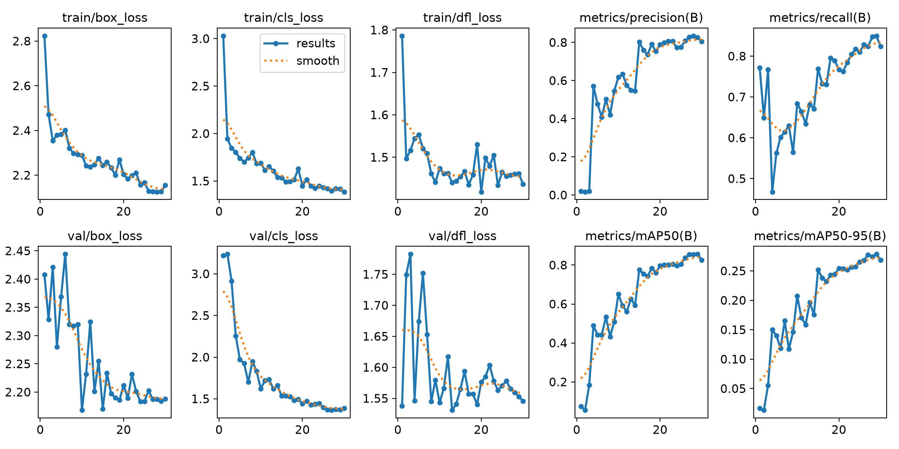

# Shrimp Seed Detection with YOLOv8

Dự án sử dụng YOLOv8 để phát hiện và đếm tôm giống trong ảnh. Repository bao gồm dataset định dạng YOLO, script huấn luyện, model đã huấn luyện và một AI service xây dựng bằng FastAPI.

> Trạng thái: phù hợp cho demo và nghiên cứu. Model cần được đánh giá lại trên tập dữ liệu độc lập trước khi sử dụng trong production.

## Chức năng

- Phát hiện một class: `shrimp-seed`.
- Đếm số lượng tôm dựa trên số bounding box sau NMS.
- Trả về confidence và tọa độ bounding box theo pixel.
- API nhận ảnh JPG/PNG qua `multipart/form-data`.
- Hỗ trợ thay đổi ngưỡng confidence và kích thước suy luận.

## Cấu trúc dự án

```text
.
├── ai_service/
│   └── main.py                 # FastAPI AI service
├── train/images/               # Ảnh huấn luyện
├── train/labels/               # Nhãn huấn luyện YOLO
├── valid/images/               # Ảnh validation
├── valid/labels/               # Nhãn validation
├── test/images/                # Ảnh test
├── test/labels/                # Nhãn test
├── runs/detect/shrimp_seed_yolov8n/
│   └── weights/best.pt         # Model dùng bởi API
├── data.yaml                   # Khai báo dataset và class
├── train_yolo.py               # Script huấn luyện
└── requirements.txt            # Python dependencies
```

## Dataset

| Split | Số ảnh | Số bounding box |
|---|---:|---:|
| Train | 210 | 1.632 |
| Validation | 60 | 459 |
| Test | 30 | 226 |
| **Tổng cộng** | **300** | **2.317** |

Toàn bộ ảnh có kích thước 640 × 640 và nhãn theo định dạng:

```text
class_id x_center y_center width height
```

Dataset được xuất từ [Roboflow Universe](https://universe.roboflow.com/toan-minh-mshdd/shrimp-seed-detection-g1fon/dataset/1) và được cung cấp theo giấy phép **CC BY 4.0**.

### Lưu ý về cách chia dữ liệu

Một số ảnh ở các split hiện có cùng tên nguồn trước hậu tố `.rf.<hash>`. Vì vậy, kết quả hiện tại có thể cao hơn khả năng tổng quát hóa trên ảnh thực tế. Khi phát triển tiếp, nên chia lại dữ liệu theo nguồn ảnh, phiên chụp hoặc lô tôm, sau đó mới thực hiện augmentation.

## Kết quả hiện tại

| Tập đánh giá | Precision | Recall | mAP50 | mAP50-95 |
|---|---:|---:|---:|---:|
| Validation | 82,66% | 84,97% | 85,58% | 27,84% |
| Test | 79,90% | 80,90% | 78,01% | 24,86% |

Ở `conf=0.25`, sai số đếm tuyệt đối trung bình trên 30 ảnh test là khoảng **1,13 con/ảnh**. Ngưỡng khoảng `0.26` cho kết quả tốt trên validation, nhưng cần hiệu chỉnh lại sau khi có tập test độc lập.



## Cài đặt

Khuyến nghị Python 3.10 hoặc 3.11.

### Windows PowerShell

```powershell
python -m venv .venv
.\.venv\Scripts\Activate.ps1
python -m pip install --upgrade pip
python -m pip install -r requirements.txt
```

### Linux/macOS

```bash
python3 -m venv .venv
source .venv/bin/activate
python -m pip install --upgrade pip
python -m pip install -r requirements.txt
```

## Huấn luyện

```powershell
python train_yolo.py
```

Script sử dụng `yolov8n.pt` làm pretrained model. Nếu file chưa tồn tại, Ultralytics sẽ tự tải trong lần chạy đầu tiên.

Model tốt nhất được lưu tại:

```text
runs/detect/shrimp_seed_yolov8n/weights/best.pt
```

## Đánh giá model

Đánh giá trên tập test:

```powershell
yolo detect val `
  model="runs/detect/shrimp_seed_yolov8n/weights/best.pt" `
  data="data.yaml" `
  split=test `
  imgsz=640
```

Dự đoán và lưu ảnh có bounding box:

```powershell
yolo detect predict `
  model="runs/detect/shrimp_seed_yolov8n/weights/best.pt" `
  source="test/images" `
  imgsz=640 `
  conf=0.25 `
  save=True
```

## Chạy AI Service

```powershell
uvicorn ai_service.main:app --host 0.0.0.0 --port 8001
```

Các địa chỉ chính:

- Swagger UI: <http://localhost:8001/docs>
- Health check: <http://localhost:8001/health>
- Prediction: `POST http://localhost:8001/predict`

Kiểm tra bằng PowerShell:

```powershell
curl.exe -X POST `
  "http://localhost:8001/predict?conf=0.25&imgsz=640" `
  -F "file=@test/images/ten-anh.jpg"
```

Response mẫu:

```json
{
  "filename": "sample.jpg",
  "image_saved": true,
  "image_url": "https://res.cloudinary.com/<cloud-name>/image/upload/...",
  "public_id": "shrimp-detection/originals/...",
  "image": {
    "width": 640,
    "height": 640
  },
  "count": 2,
  "detections": [
    {
      "class_id": 0,
      "class": "shrimp-seed",
      "confidence": 0.87,
      "box": {
        "x1": 120.2,
        "y1": 80.5,
        "x2": 180.9,
        "y2": 145.3
      }
    }
  ]
}
```

Có thể sử dụng model ở vị trí khác bằng biến môi trường:

```powershell
$env:MODEL_PATH = "D:\models\shrimp\best.pt"
uvicorn ai_service.main:app --host 0.0.0.0 --port 8001
```

### Cấu hình Cloudinary

SDK Cloudinary đã được khai báo trong `requirements.txt`. Để cấu hình khi phát triển trên máy cá nhân, sao chép `.env.example` thành `.env` và điền credentials lấy từ Cloudinary Console:

```text
CLOUDINARY_CLOUD_NAME=...
CLOUDINARY_API_KEY=...
CLOUDINARY_API_SECRET=...
```

File `.env` đã được Git ignore. Khi deploy, hãy cấu hình ba giá trị này trong phần environment variables/secrets của nền tảng chạy service; không đưa API secret vào source code hoặc repository. Nếu chưa cấu hình credential nào, service vẫn có thể khởi động; `/health` sẽ trả `cloudinary_configured: false`, còn `/predict` trả HTTP 503. Khi cấu hình thiếu một hoặc hai giá trị, service báo lỗi lúc khởi động để tránh chạy với thiết lập không đầy đủ. Khi Cloudinary từ chối hoặc không nhận được upload, `/predict` trả HTTP 502 để báo ảnh chưa được backup.

### Chạy kiểm thử

Các bài kiểm thử dùng `unittest` và mock Cloudinary, nên không cần tài khoản Cloudinary hoặc credentials:

```powershell
python -m unittest discover -s tests -v
```

Các test bao gồm Cloudinary chưa cấu hình, upload thành công, lỗi upload và ảnh không hợp lệ.

## Đưa dự án lên GitHub

Tạo một repository trống trên GitHub, sau đó chạy tại thư mục dự án:

```powershell
git init
git add .
git commit -m "Initial commit: shrimp seed detection"
git branch -M main
git remote add origin https://github.com/<username>/<repository>.git
git push -u origin main
```

Thay `<username>` và `<repository>` bằng thông tin repository của bạn. File `.venv`, cache, checkpoint trung gian và kết quả predict sẽ không được commit. `best.pt` vẫn được giữ để API có thể chạy sau khi clone.

Nếu model trong tương lai vượt giới hạn dung lượng của GitHub, hãy lưu model bằng Git LFS hoặc GitHub Releases.

## Tài liệu bổ sung

- [Hướng dẫn sử dụng và kiểm thử](HOW_TO_USE_AND_TEST.md)
- [Hướng dẫn AI Service](AI_SERVICE_GUIDE.md)
- [Hướng dẫn tích hợp AI Service](HUONG_DAN_TICH_HOP_AI_SERVICE.md)
- [Hướng dẫn triển khai Docker](HUONG_DAN_DOCKER_AI_SERVICE.md)
- [Trạng thái chi tiết của dự án](PROJECT_STATUS.md)

## Hạn chế hiện tại

- Dataset còn nhỏ và có nguy cơ trùng nguồn giữa các split.
- Bounding box chưa chính xác ở các ngưỡng IoU cao.
- Chưa có giao diện người dùng, database hoặc lưu lịch sử nhận diện.
- API chưa có giới hạn upload, authentication và cơ chế điều phối nhiều request.
- Chưa có bộ test tự động và pipeline CI/CD.

## Giấy phép

Dataset sử dụng giấy phép CC BY 4.0; khi tái sử dụng cần giữ thông tin nguồn và ghi công tác giả dataset. Mã nguồn trong repository hiện chưa được gán giấy phép riêng.
# shrimp-seed-detection.v1i.yolov8
